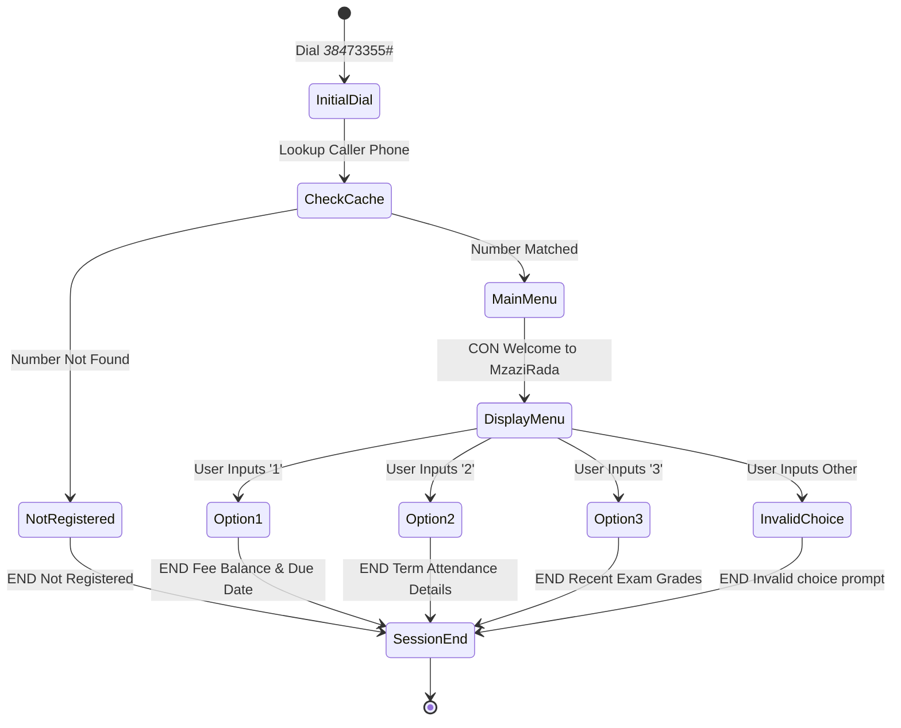

# MzaziRada System Architecture

MzaziRada is an educational gateway engineered for low-connectivity environments. It bridges accessible administrative tooling (Google Sheets) with universal telecommunications infrastructure (USSD & SMS).

---

## 1. System Topology

```mermaid
flowchart TD
    subgraph Administration["School Administrative Layer"]
        GS["Google Sheets (Students & FeeLedger)"]
        GAS["Google Apps Script (Code.gs)"]
        GS -->|Triggers & Menu| GAS
    end

    subgraph Gateway["MzaziRada Core Backend (FastAPI)"]
        WH["POST /api/v1/webhook/update-student"]
        AUTH["Bearer / Secret Token Validator"]
        CACHE[("In-Memory State Cache\nPhone -> Student Record")]
        FSM["USSD Finite State Machine\nMenu Engine"]
        USSD_EP["POST /api/v1/ussd"]
        
        WH --> AUTH
        AUTH -->|Valid| CACHE
        USSD_EP --> FSM
        FSM <-->|O(1) Sub-10ms Read| CACHE
    end

    subgraph Telecom["Africa's Talking Telecom Layer"]
        AT_SMS["SMS Gateway Service"]
        AT_USSD["USSD Session Gateway (*384*XXXX#)"]
    end

    subgraph EndUsers["Parents & Guardians"]
        SMART["Smartphones"]
        FEATURE["Feature Phones (2G / Basic)"]
    end

    GAS -->|HTTPS JSON Payload| WH
    WH -.->|Async Push| AT_SMS
    AT_SMS -->|SMS Notification| SMART & FEATURE
    SMART & FEATURE <-->|Dial USSD Session| AT_USSD
    AT_USSD <-->|Form POST / Plaintext Response| USSD_EP
```

---

## 2. USSD Session State Machine

Telecom providers enforce strict timeouts (typically 15 to 20 seconds total, requiring response times under 2 seconds per menu step). To guarantee sub-10ms latency, MzaziRada utilizes an in-memory dictionary cache indexed by E.164 phone numbers.



---

## 3. Data Flow & Security Protocol

### Webhook Ingestion (`/api/v1/webhook/update-student`)
1. **Authentication**: Requests must supply a matching `secret` token in the JSON body. Unauthorized calls immediately terminate with HTTP 401.
2. **Cache Synchronization**: Records are indexed directly by normalized phone number (`+254XXXXXXXXX`).
3. **SMS Dispatch**: If `send_sms` is enabled, an outbound message is queued via Africa's Talking SMS API.

### USSD Callback (`/api/v1/ussd`)
1. Africa's Talking sends HTTP POST with `application/x-www-form-urlencoded` containing:
   - `sessionId`: Unique identifier for the USSD dialogue.
   - `serviceCode`: Shortcode dialed.
   - `phoneNumber`: Caller's MSISDN.
   - `text`: Input chain delimited by `*` (e.g., `""`, `"1"`, `"2"`).
2. The endpoint returns `text/plain` prefixed with:
   - `CON`: Continue the session, expect next input.
   - `END`: Terminate session and show final message.

---

## 4. Latency & Performance Strategy

| Feature | Implementation | Benchmark |
| :--- | :--- | :--- |
| **Cache Lookup** | In-Memory Dictionary (`app/core/cache.py`) | `< 1 ms` |
| **USSD Evaluation** | Pure Python FSM parsing (`app/core/state_machine.py`) | `< 2 ms` |
| **HTTP Response** | Plain text `Response(..., media_type="text/plain")` | `< 10 ms` |
| **Cold Starts** | Zero database connection overhead on initial requests | Instantaneous |
