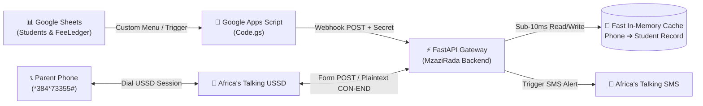

# MzaziRada 📱🏫

> **MzaziRada is an accessible education gateway built for low-connectivity communities. It allows parents with basic 2G feature phones (*kabambe*) to instantly check their child's school fee balances, exam performance, and attendance records via USSD (`*384*XXXX#`) powered by Africa's Talking.**  
>  
> **The entire workflow is deliberately lightweight: schools manage their records directly in familiar Google Sheets, while Google Apps Script automatically syncs updates and triggers instant USSD access and SMS alerts.**

---

[](https://www.python.org/)
[](https://fastapi.tiangolo.com)
[](https://africastalking.com/)
[](LICENSE)
[](tests/)

---

## 💡 Why MzaziRada Matters

### The Problem: The Education Digital Divide
In primary and secondary schools across emerging markets in Sub-Saharan Africa:
* **The Smartphone & Data Barrier**: Millions of parents do not own smartphones, lack reliable home Wi-Fi, or cannot afford expensive mobile data bundles to access web portals. However, nearly 100% of families have access to basic 2G GSM feature phones (*kabambe* / button phones).
* **Communication Latency**: Parents often travel long distances or wait until end-of-term paper report cards to discover fee arrears, attendance issues, or exam grades.
* **Administrative Complexity**: Small to mid-sized schools cannot afford \$5,000/year enterprise ERP systems. Teachers and bursars already manage student data using familiar spreadsheets like **Google Sheets**.

### The Solution: MzaziRada
**MzaziRada** (*"Mzazi"* = Parent in Swahili, *"Rada"* = On the alert / radar in Sheng) connects the school's administrative spreadsheet directly to universal telecommunications infrastructure:
1. **Zero New Software for Schools**: School administrators manage records in **Google Sheets** as usual.
2. **One-Click Real-Time Sync**: Google Apps Script pushes updates to a high-speed **FastAPI** backend via secure webhooks.
3. **Instant Self-Service for Parents**: Parents dial a shortcode (e.g., `*384*73355#`) on **any phone** to view live fee balances, attendance, and exam grades in sub-10 milliseconds without internet.
4. **Automated SMS Reminders**: Schools trigger instant, personalized SMS alerts whenever fee ledgers are updated.

---

## 🌟 The 4 Core Value Pillars

| Pillar | What It Means for Parents & Schools |
| :--- | :--- |
| **Universal 100% Phone Reach** | Accessible on **any** device—from a basic \$10 button phone to the latest smartphone. No apps to install, no passwords to remember, and zero mobile data consumed. |
| **Instant Transparency & Peace of Mind** | Parents check tuition balances and attendance in seconds, preventing unexpected student suspensions and keeping guardians informed. |
| **Zero Administrative Friction** | Administrators continue working inside Google Sheets. A custom menu (**"📢 Send Fee Reminders"**) automates communication directly from sheet rows. |
| **Carrier-Grade Sub-10ms Performance** | Built with an in-memory state machine engine that responds to telecom gateway callbacks well within strict carrier timeout thresholds. |

---

## 📲 The Parent Experience (3-Step Walkthrough)

```
Step 1: School Updates Records in Google Sheets
        Bursar logs fee payment or exam mark ➔ clicks "Send Fee Reminders"

Step 2: Instant Parent SMS Alert
        "MzaziRada Alert: Jane Doe's records have been updated. 
         Outstanding: KES 15,000. Dial *384*73355# anytime for full details."

Step 3: Dial *384*73355# Anytime for Interactive USSD Self-Service
        ┌────────────────────────────────────┐
        │ Welcome to MzaziRada!              │
        │ Student: Jane Doe                  │
        │ 1. Check Fee Balance               │
        │ 2. View Attendance                 │
        │ 3. View Recent Grades              │
        └────────────────────────────────────┘
         User inputs '1':
        ┌────────────────────────────────────┐
        │ Fee Balance for Jane Doe (ADM-1001)│
        │ Outstanding: KES 15,000            │
        └────────────────────────────────────┘
```

---

## 🏗️ System Architecture



Detailed architecture diagrams and state machine specifications are documented in [ARCHITECTURE.md](ARCHITECTURE.md).

---

## ✨ Technical Highlights

- **Sub-10ms USSD Engine**: In-memory finite state machine parses asterisk-delimited session chains (`1`, `1*2`) with sub-millisecond execution.
- **Zero-Internet Accessibility**: Operates over GSM signaling channels (USSD and SMS).
- **Secure Webhook Verification**: Shared secret tokens protect endpoints against unauthorized updates.
- **Automated SMS Alerts**: Dispatches personalized fee reminders directly to parent phone numbers via Africa's Talking.
- **Full Test Coverage**: Comprehensive Pytest suite covering 100% of the USSD state machine and webhook endpoints.

---

## 📁 Repository Structure

```
mzazirada/
├── .env.example                 # Environment configuration template
├── .gitignore                   # Comprehensive git exclusions (secrets, venv, cache)
├── LICENSE                      # MIT Open Source License
├── README.md                    # Main documentation & showcase
├── ARCHITECTURE.md              # Deep dive into system design & state machine
├── CONTRIBUTING.md              # Guidelines for open source contributors
├── pytest.ini                   # Pytest path and runner configuration
├── requirements.txt             # Production Python dependencies
├── requirements-dev.txt         # Development & testing dependencies
│
├── apps_script/
│   ├── Code.gs                  # Google Apps Script for Google Sheets integration
│   ├── appsscript.json          # Apps Script manifest
│   └── README.md                # Google Sheets & Apps Script setup guide
│
├── backend/
│   ├── .env.example             # Backend local environment template
│   ├── requirements.txt         # Backend dependency list
│   └── app/
│       ├── main.py              # FastAPI app instance and router registration
│       ├── config.py            # Pydantic v2 application settings
│       ├── api/
│       │   ├── ussd.py          # Africa's Talking USSD callback handler (Form POST)
│       │   └── webhook.py       # Google Apps Script student update webhook
│       ├── core/
│       │   ├── cache.py         # Fast in-memory student record store
│       │   └── state_machine.py # USSD CON/END state machine processor
│       ├── schemas/
│       │   └── payloads.py      # Pydantic models for incoming webhooks
│       └── services/
│           └── africastalking_service.py # Africa's Talking SMS dispatcher
│
├── sample_data/
│   ├── students.csv             # Mock student demographics, phone numbers & grades
│   ├── fee_ledger.csv           # Mock student fee payments & balances
│   ├── webhook_payload_sample.json # Sample payload from Google Apps Script
│   ├── ussd_callback_sample.json   # Sample payload from Africa's Talking USSD
│   └── README.md                # Guide to importing mock data
│
└── tests/
    ├── __init__.py
    ├── test_state_machine.py    # Unit tests for USSD menu navigation
    └── test_api_endpoints.py    # Integration tests for USSD and Webhook endpoints
```

---

## 🔒 Security & Privacy Practices

- **Zero Credentials in Code**: No API keys, carrier credentials, or webhook secrets are committed. All secrets are loaded via environment variables.
- **Git Protection**: [.gitignore](.gitignore) prevents accidental commits of `.env`, cache files, and private logs.
- **Sanitized Mock Data**: All phone numbers (`+254712345678`), names, and student records in [sample_data/](sample_data/) are strictly fictional.
- **Webhook Authentication**: Incoming updates from Google Apps Script require matching the `WEBHOOK_SECRET` token.

---

## 🚀 Quick Start Guide

### 1. Prerequisites
- **Python 3.10+** installed
- An **[Africa's Talking](https://africastalking.com/)** account (Free Sandbox mode is sufficient)
- A **Google account** (for Google Sheets testing)

### 2. Clone and Setup Environment

```bash
# Clone the repository
git clone https://github.com/smartdes/mzazirada.git
cd mzazirada

# Create and activate a virtual environment
python -m venv venv

# On Linux/macOS:
source venv/bin/activate
# On Windows PowerShell:
.\venv\Scripts\Activate.ps1

# Install dependencies
pip install -r requirements-dev.txt
```

### 3. Configure Environment Variables

Copy `.env.example` to `.env`:
```bash
cp .env.example .env
```

Configure your Africa's Talking sandbox or live credentials:
```ini
AT_USERNAME=sandbox
AT_API_KEY=your_africastalking_api_key_here
AT_SHORTCODE=*384*73355#
WEBHOOK_SECRET=your_secure_random_webhook_secret_here
```

### 4. Run the Backend Server

Start the development server with Uvicorn:
```bash
uvicorn app.main:app --reload --app-dir backend
```

The API will be live at:
- **API Root**: `http://localhost:8000/`
- **Interactive OpenAPI Docs**: `http://localhost:8000/docs`

---

## 🧪 Running Tests

Run the automated test suite using `pytest`:

```bash
pytest -v
```

All 12 unit and integration tests run in under 2 seconds:
```
tests/test_api_endpoints.py::test_health_check PASSED
tests/test_api_endpoints.py::test_ussd_endpoint_initial_dial PASSED
tests/test_api_endpoints.py::test_ussd_endpoint_menu_selection PASSED
tests/test_api_endpoints.py::test_webhook_update_success PASSED
tests/test_api_endpoints.py::test_webhook_unauthorized_secret PASSED
tests/test_api_endpoints.py::test_webhook_missing_required_fields PASSED
tests/test_state_machine.py::test_ussd_initial_dial_shows_main_menu PASSED
tests/test_state_machine.py::test_ussd_select_fee_balance PASSED
tests/test_state_machine.py::test_ussd_select_attendance PASSED
tests/test_state_machine.py::test_ussd_select_recent_grades PASSED
tests/test_state_machine.py::test_ussd_invalid_option PASSED
tests/test_state_machine.py::test_ussd_unregistered_phone_number PASSED

======================= 12 passed in 1.25s =======================
```

---

## 🌐 Connecting to Africa's Talking Simulator

To test the USSD flow interactively without telecom fees:

1. **Expose Localhost via Tunnel**:
   ```bash
   ngrok http 8000
   ```
   Copy your forwarding HTTPS URL (e.g., `https://xyz.ngrok-free.app`).

2. **Configure Africa's Talking Sandbox**:
   - Log into the [Africa's Talking Sandbox Dashboard](https://account.africastalking.com/).
   - Navigate to **USSD > Service Codes > Create Channel**.
   - Set Channel Shortcode (e.g., `*384*73355#`).
   - Set Callback URL to:  
     `https://xyz.ngrok-free.app/api/v1/ussd`
   - Save the channel.

3. **Launch the Web Simulator**:
   - In Africa's Talking, open the **USSD Simulator**.
   - Enter your registered test phone number (`+254712345678`).
   - Dial `*384*73355#`.
   - The interactive MzaziRada menu will appear on the simulated screen!

---

## 📊 Google Sheets & Apps Script Integration

1. Follow the instructions in [sample_data/README.md](sample_data/README.md) to populate your sheet with `students.csv` and `fee_ledger.csv`.
2. Follow the steps in [apps_script/README.md](apps_script/README.md) to add `Code.gs` to **Extensions > Apps Script**.
3. Use the **MzaziRada SMS > Setup Script Properties** menu in your spreadsheet to link your backend URL and `WEBHOOK_SECRET`.
4. Click **MzaziRada SMS > Send Fee Reminders to Parents** to trigger updates and SMS alerts automatically!

---

## 🗺️ Roadmap

- [ ] Multi-tenant support (Multiple schools separated by tenant ID).
- [ ] Multilingual USSD menu switching (English & Kiswahili).
- [ ] Persistent SQLite / PostgreSQL storage with Redis caching.
- [ ] Automated M-Pesa Daraja STK Push integration for instant fee settlement directly from the USSD session.

---

## 📄 License

This project is licensed under the [MIT License](LICENSE).
Feel free to use and adapt this project for educational and community impact.
